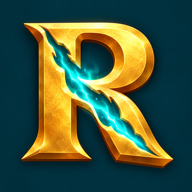
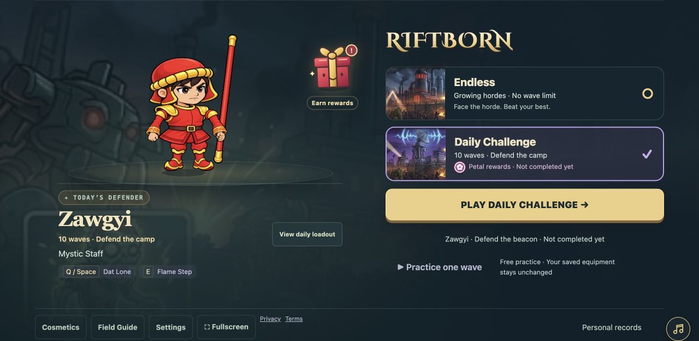
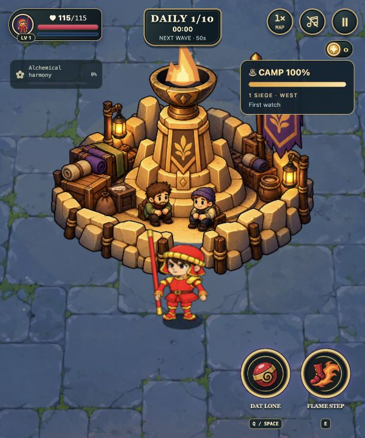
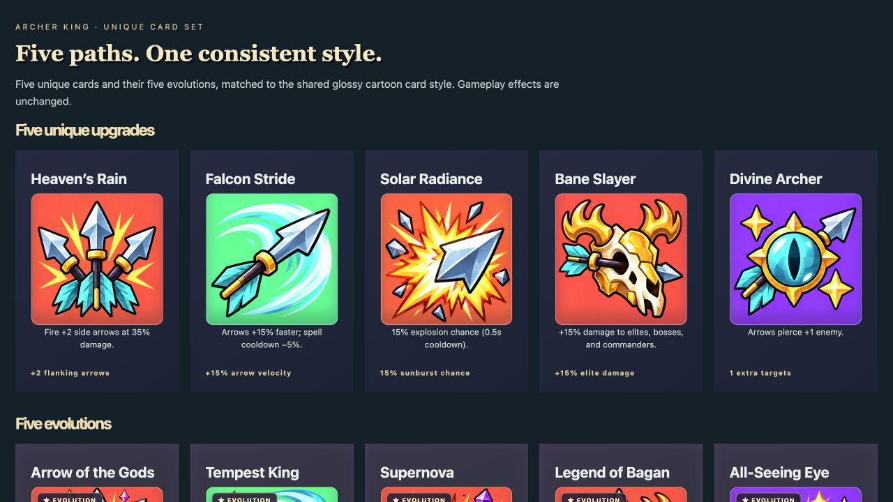

<div align="center">
  

# RIFTBORN

### One survivor. An evolving arsenal. A last light worth defending.

A browser action roguelite where cute fantasy heroes face relentless zombies and robots.
Dodge the horde, shape your build, and awaken the weapon that carries your next stand.

**[▶ PLAY RIFTBORN](https://zombie-last-stand.vercel.app/) · [Quick start](#run-locally) · [Controls](#controls)**

**Play in your browser · Desktop & mobile · No account required to start**

</div>



## Your next stand starts here

**Survive. Adapt. Come back stronger.** Collect XP, choose upgrades, and combine character-specific techniques with shared powers. Turn a simple attack into a crowd-clearing build, then see how long you can keep it alive.

| Endless | Daily Challenge |
| --- | --- |
| Pick your survivor and loadout. Face growing waves and chase a personal best. | Take today's shared survivor and loadout into a ten-wave camp defence. |
| Awaken after wave 10; fully evolve your element after wave 20. | Awaken after wave 5, reinforce the camp, and survive the final siege. |

## Protect the last light

The Daily Challenge gives the fight a second purpose: **keep the camp standing while keeping yourself alive.** Some enemies hunt you; marked attackers head for the camp. Choose your priorities, recover between waves, and call on a little woodland guardian to help defend the beacon.

<p align="center">
  
</p>

## Seven survivors. Seven ways to fight.

| Survivor | Find your playstyle |
| --- | --- |
| **Ninja** | Fast melee attacks, shadow techniques, and a dash out of danger. |
| **Samurai** | Powerful sword strikes, counters, and sweeping blade skills. |
| **Gunner** | Ranged pressure, explosive tools, and tactical reloads. |
| **Shield Tank** | Frontal defence, shield impacts, and ground-shaking attacks. |
| **Zawgyi** | Magic staff combat with Dat Lone, Flame Step, or Staff Slam. |
| **Archer King** | Duskstring Bow volleys, piercing arrows, and wind-powered archery. |
| **Lethwei Master** | Close-range punches, nine-limb combos, and a spirit boxing ring. |

Customize your survivor with outfits and weapon skins, then choose the skills that suit your next run. Ninja uses his signature Shadow Dash; the other survivors equip two skills.

## Build something worth surviving for

Shared upgrades support damage, movement, recovery, and crowd control. Each survivor also has **five unique cards** with their own evolutions. Max an eligible card to put its evolution into the level-up choice pool. The Field Guide lets you inspect cards and plan a build before entering combat.



*Card gallery shown in the development preview; these designs are used by the game's cards.*

Weapon awakening adds another choice for the run:

| Element | Awakening | Full evolution in Endless |
| --- | --- | --- |
| **Lightning** | Chain lightning to a nearby enemy. | Chain through more enemies and gain piercing projectiles. |
| **Wildfire** | Ignite enemies on hit. | Add explosive attacks and burning ground on kills. |
| **Phantom** | Faster attacks and an echo every third attack. | More attack speed and an echo on every attack. |

## Earn your next reward

Open the floating gift on the home screen to preview rewards, check progress, and claim them when ready.

- **Lethwei Master:** clear wave 15 in Endless.
- **Fox Ronin:** clear your first Daily Challenge to earn Samurai's outfit.

**Both rewards are earned through play. Neither can be bought with Gold or Petals.** New saves start with **0 Gold and 0 Petals**; play to earn currency for purchases.

## Controls

| Action | Desktop | Mobile |
| --- | --- | --- |
| Move | WASD / arrow keys | On-screen joystick |
| Aim | Mouse; directional input when aiming skills | Drag a skill button to aim |
| Attack | Automatic combat; hold left click for applicable weapon actions | Automatic when a target is in range |
| First skill / Ninja dash | Q / Space | First skill button |
| Second skill, where equipped | E | Second skill button |
| Cancel skill aim | Escape / right click | Drag to the cancel area |
| Pause | Escape / pause button | Pause button |
| Choose an upgrade | Click or press 1, 2, 3 | Tap a card |

**Phones are best played sideways.** Joystick placement and size are configurable. The map-view button cycles **1× → 1.5× → 2×**, with 1.5× as the default on mobile. Fullscreen availability depends on the browser and device; portrait remains playable.

## Progress and accounts

Guest play saves progress in the current browser. Optional Supabase sign-in supports account progress and cloud saves when configured. Guest and account progress are separate; guest progress is not imported into an account.

Local saves belong to the site's origin: localhost, a phone's network address, and the hosted game have separate storage. Clearing browser storage removes local progress. Daily records are personal records, not a public online leaderboard.

## Run locally

Built with **TypeScript · Phaser 3 · Vite**, with optional **Supabase** accounts.

Requires **Node.js 20.19+ or 22.12+** and npm.

```bash
git clone https://github.com/minntayza/zombie-last-stand.git
cd zombie-last-stand
npm ci
npm run dev
```

Open the address printed by Vite. For a phone on the same Wi-Fi network, use the printed network address. The development server listens on all network interfaces.

```bash
npm run build    # Type-check and build to dist/
npm run preview  # Preview the production build
npm test         # Run automated tests
```

Guest play does not require backend credentials. To enable accounts, configure the public browser values documented in [.env.example](.env.example) and set up the Supabase project using [supabase/](supabase/). Never expose a service-role key in the browser.

## Development and testing

The repository includes unit tests, in-engine checks, and visual previews. With the development server running:

- `tests/browser.html` — in-engine integration checks.
- `tests/universal-aim-preview.html` — survivor skill-aiming practice.
- `tests/camp-guardian-preview.html` — camp guardian and siege presentation.
- `tests/evolution-showcase.html` — card and weapon evolution previews.
- `tests/mobile-review.html` — responsive layout review.

Automated checks complement browser inspection. Real-phone testing is still needed for touch comfort, long-session performance, and device-specific fullscreen behavior.

| Location | Responsibility |
| --- | --- |
| `src/main.ts` | Menus, navigation, HUD integration, and persistence |
| `src/combat.ts` | Arena scene, combat, enemies, and wave lifecycle |
| `src/*-combat.ts` | Character-specific combat systems |
| `src/upgrades.ts`, `src/card-evolutions.ts` | Card choices and evolution effects |
| `src/last-camp*.ts`, `src/camp-guardian.ts` | Camp defence and guardian |
| `src/save.ts`, `src/accounts.ts` | Local progress and account integration |
| `public/assets/` | Runtime art assets |
| `tests/` | Automated checks and development previews |
| `docs/screenshots/` | README screenshots |

## Deploy

Run `npm run build` and publish `dist/` to a static host. Vercel build settings are in [vercel.json](vercel.json). Set the optional Supabase environment values on the host if accounts are enabled. For subdirectory hosting, configure Vite's base path.

---

**[Take your next stand →](https://zombie-last-stand.vercel.app/)**
