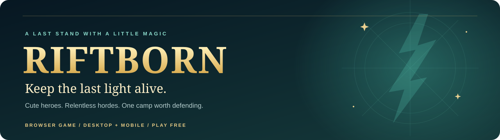

<p align="center">
  
</p>

<div align="center">

# Your next run has something worth fighting for.

**A browser survival roguelite with Burmese-inspired heroes, evolving builds, and a camp that needs you.**

Survive zombies and robots. Discover your favorite hero. Return for a new daily defense.

<a href="https://riftborn-survival.vercel.app/"></a>

**No download · No account required to start · Desktop and mobile**

[The game in 30 seconds](#the-game-in-30-seconds) · [Why come back?](#built-around-one-more-run) · [Burmese heroes](#burmese-inspiration-at-the-heart-of-the-roster) · [How to run](#run-it-yourself)

</div>

[](https://riftborn-survival.vercel.app/)

## The game in 30 seconds

**You move. Your hero attacks. You decide what happens next.**

1. **Choose your fight.** Bring your own survivor into Endless, or play today's assigned survivor and loadout in Daily Challenge.
2. **Build as you survive.** Defeat enemies, collect XP, and choose upgrade cards. Mix shared powers with your hero's five unique cards.
3. **Find your turning point.** Evolve your cards and awaken your weapon with Lightning, Wildfire, or Phantom.
4. **Leave with a reason to return.** Chase a better run, earn an exclusive reward, or come back for the next daily defense.

| Endless: test your build | Daily Challenge: protect something |
| --- | --- |
| Your survivor. Your loadout. Growing waves with no fixed finish. | Today's shared survivor and loadout. Ten waves. One camp to defend. |
| Chase personal bests and earn Gold. | Split your attention between your own survival and the camp. Earn Petals from wave clears. |
| Weapon awakening after Wave 10; full elemental evolution after Wave 20. | Weapon awakening after Wave 5, camp reinforcement choices, and a final siege. |

## Built around “one more run”

RIFTBORN's retention design connects **a satisfying fight now, a visible goal next, and a different challenge tomorrow.** These are design goals, not claims of measured player retention.

| When | What brings the player back | How the game supports it |
| --- | --- | --- |
| **During a run** | “One more upgrade could complete this build.” | XP choices, five unique cards per hero, card evolutions, and elemental weapon awakenings. |
| **After a defeat** | “I can get further with a different approach.” | Personal records, run results, and different survivors, skills, and upgrade combinations. |
| **Across runs** | “I know what I'm working toward.” | Gift previews show the reward, its unlock condition, progress, and a manual claim when earned. |
| **Tomorrow** | “Who is defending the camp today?” | A daily survivor and loadout create a fresh starting point for the ten-wave camp defense. |
| **Over time** | “I want to master another hero.” | Seven fighting styles, character-specific evolutions, outfits, and weapon skins. |

**The promise is simple: make progress easy to understand before asking players to invest another run.**

### Two rewards you earn, not buy

| Reward | Your goal | Why it matters |
| --- | --- | --- |
| **Lethwei Master — playable survivor** | Clear Wave 15 in Endless, then claim him from the home-screen gift. | A concrete survival milestone unlocks a new close-range fighting style. |
| **Fox Ronin — Samurai outfit** | Clear your first Daily Challenge, then claim it from the gift. | Your first successful camp defense leaves you with a visible reward. |

Neither reward can be purchased with Gold or Petals. The gift stays marked until both rewards are claimed. You can inspect the characters before earning them.

New saves start with **0 Gold and 0 Petals**. Endless awards **Gold, never Petals**. Clearing Endless Waves 1–15 awards **1,600 Gold** in total. A full ten-wave Daily Challenge awards **900 Gold and 250 Petals**. Gold pickups and bonuses count toward each wave’s budget; clearing the wave pays the remainder. Daily Challenge wave clears award Petals. Outfits and weapon skins offer additional collection goals.

## Burmese inspiration at the heart of the roster

RIFTBORN brings Burmese-inspired fantasy and martial arts into a colorful, approachable survivor game. These heroes are stylized game interpretations, not historical recreations.

| Hero | Inspiration and identity | What you see in combat |
| --- | --- | --- |
| **Zawgyi** | A fantasy interpretation of the Burmese magical figure. | Staff combat and skills such as **Dat Lone**, **Flame Step**, and **Staff Slam**. |
| **Lethwei Master** | Inspired by Myanmar's close-range martial art, Lethwei. | Wrapped fists, aggressive punches, nine-limb combos, and a spirit boxing ring. |
| **Archer King** | A fantasy royal archer within the game's Burmese-inspired cast. | The **Duskstring Bow**, piercing arrows, volleys, and wind-powered archery. |

Four more survivors broaden the ways to play:

| Survivor | Fighting style |
| --- | --- |
| **Ninja** | Fast blades, shadow techniques, and a signature dash. |
| **Samurai** | Heavy sword strikes, counters, and sweeping blade skills. |
| **Gunner** | Ranged pressure, explosive tools, and tactical reloads. |
| **Shield Tank** | Frontal defense, shield impacts, and ground-shaking attacks. |

Ninja uses **Shadow Dash**. Other survivors equip **two skills**. Choose a survivor for the way they fight, then customize their appearance with outfits and weapon skins.

## A camp worth defending

In Daily Challenge, some enemies pursue you while marked siege attackers head for the camp. Saving yourself is only half the job.

Between waves, choose how to reinforce your defense. Summon a **small woodland guardian** to fight nearby camp attackers, then hold the beacon through the final siege.

<p align="center">
  
</p>

**The memorable moment:** your guardian arrives, the last siege begins, and the camp is still standing because you protected it.

## From a simple attack to your own build

Shared cards support damage, movement, recovery, and crowd control. Each survivor adds **five unique cards with their own evolutions**. Max an eligible card to bring its evolution into the upgrade choice pool. Inspect the possibilities in the Field Guide before starting a run.


*Development gallery showing artwork used by the game's upgrade cards.*

Weapon awakenings add an elemental identity to your run:

- **Lightning:** chain damage between enemies.
- **Wildfire:** ignite enemies and develop explosive attacks.
- **Phantom:** attack faster and create ghostly attack echoes.

Full evolutions strengthen these effects. Their behavior follows the equipped weapon, so a staff, bow, and melee weapon keep their own combat identity.

## Your first run

1. Open **[RIFTBORN](https://riftborn-survival.vercel.app/)** and start as a guest.
2. Pick **Endless** to explore your own build, or **Daily Challenge** to defend the camp with today's loadout.
3. Keep moving, collect XP, and choose cards that support your fighting style.
4. Use skills to escape pressure or break dangerous groups.
5. After the run, check your results and open the home-screen gift to see your next reward goal.

**On a phone, play sideways for more room.** Portrait is also playable. The map-view button cycles **1× → 1.5× → 2×**. Mobile defaults to 1.5×; desktop defaults to 1× in Endless and 1.5× in Daily Challenge. Fullscreen support depends on the device and browser.

<details>
<summary><strong>Controls</strong></summary>

| Action | Desktop | Mobile |
| --- | --- | --- |
| Move | WASD / arrow keys | On-screen joystick |
| Basic attack | Automatic combat | Automatic when a target is in range |
| First skill / Ninja dash | Q / Space | First skill button |
| Second skill, where equipped | E | Second skill button |
| Aim a skill | Hold and aim with the mouse | Hold and drag a skill button |
| Cancel skill aim | Escape / right click | Drag to the cancel area |
| Pause | Escape / pause button | Pause button |
| Choose an upgrade | Click or press 1, 2, 3 | Tap a card |

Joystick size and placement are configurable in Settings.

</details>

## Run it yourself

**Built with TypeScript, Phaser 3, and Vite. Optional Supabase accounts and cloud saves.**

Install **Node.js 20.19+ or 22.12+** and npm, then:

```bash
git clone https://github.com/minntayza/RIFTBORN-Survival.git
cd RIFTBORN-Survival
npm ci
npm run dev
```

Open the **Local** URL printed by Vite. To test on a phone, connect it to the same Wi-Fi network and open the printed **Network** URL. The development server listens on all network interfaces.

**No backend credentials are needed for guest play.**

```bash
npm test         # Run automated tests
npm run build    # Type-check and create the production build in dist/
npm run preview  # Serve the production build locally
```

<details>
<summary><strong>Optional accounts and saved progress</strong></summary>

Guest progress is stored in the current browser. Supabase sign-in enables account progress and cloud saves when configured. Guest and account progress are separate; signing in does not import the guest save.

To enable accounts, copy `.env.example` to `.env.local`, fill in the public browser credentials, and follow [the account setup guide](docs/accounts-setup.md). Never put a Supabase service-role key in browser configuration.

Localhost, a phone's network URL, and the hosted game each have separate browser storage. Clearing that storage removes local guest progress. Daily records are personal records, not a public leaderboard.

</details>

<details>
<summary><strong>Developer previews and project structure</strong></summary>

With the development server running, open:

| Preview | Purpose |
| --- | --- |
| `/tests/browser.html` | In-engine integration checks |
| `/tests/universal-aim-preview.html` | Survivor skill aiming |
| `/tests/camp-guardian-preview.html` | Guardian and siege presentation |
| `/tests/evolution-showcase.html` | Card and weapon evolutions |
| `/tests/mobile-review.html` | Responsive layout review |

| Location | Responsibility |
| --- | --- |
| `src/main.ts` | Menus, navigation, HUD, and persistence |
| `src/combat.ts` | Arena combat, enemies, and waves |
| `src/*-combat.ts` | Character combat systems |
| `src/upgrades.ts`, `src/card-evolutions.ts` | Upgrade cards and evolutions |
| `src/last-camp*.ts`, `src/camp-guardian.ts` | Camp defense and guardian |
| `src/save.ts`, `src/accounts.ts` | Saves and accounts |
| `public/assets/` | Runtime artwork |
| `tests/` | Automated checks and visual previews |

Automated checks complement browser inspection. Physical-phone testing is still needed for touch comfort, long-session performance, and browser-specific behavior.

</details>

<details>
<summary><strong>Deploy</strong></summary>

Run `npm run build` and publish `dist/` to a static host. Vercel settings are in [vercel.json](vercel.json). Configure the optional Supabase environment values on your host if accounts are enabled. For subdirectory hosting, configure Vite's base path.

</details>

---

<p align="center"><strong>Choose a hero. Build your next breakthrough. Keep the last light alive.</strong></p>
<p align="center"><a href="https://riftborn-survival.vercel.app/">Play RIFTBORN</a> · <a href="https://github.com/minntayza/RIFTBORN-Survival">Explore the source</a></p>
