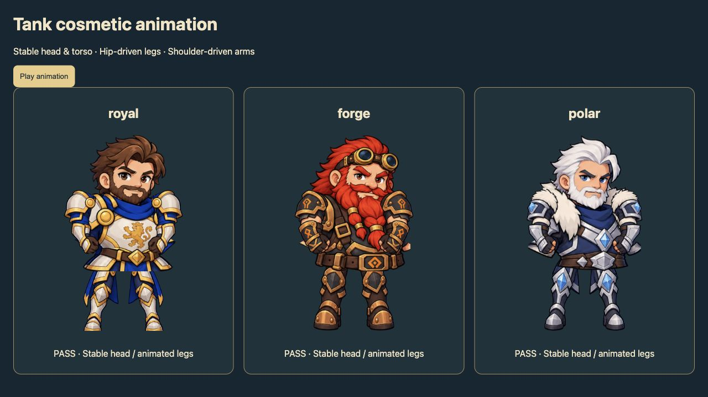
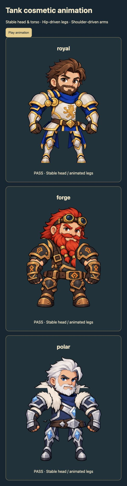
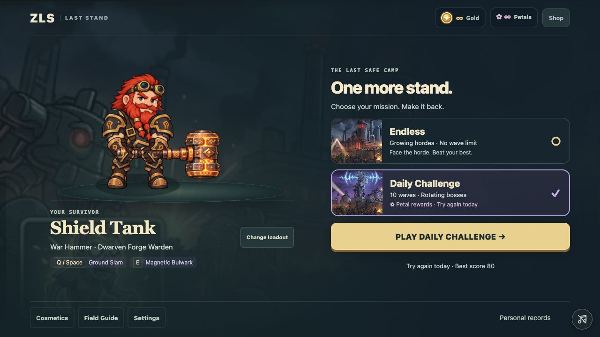
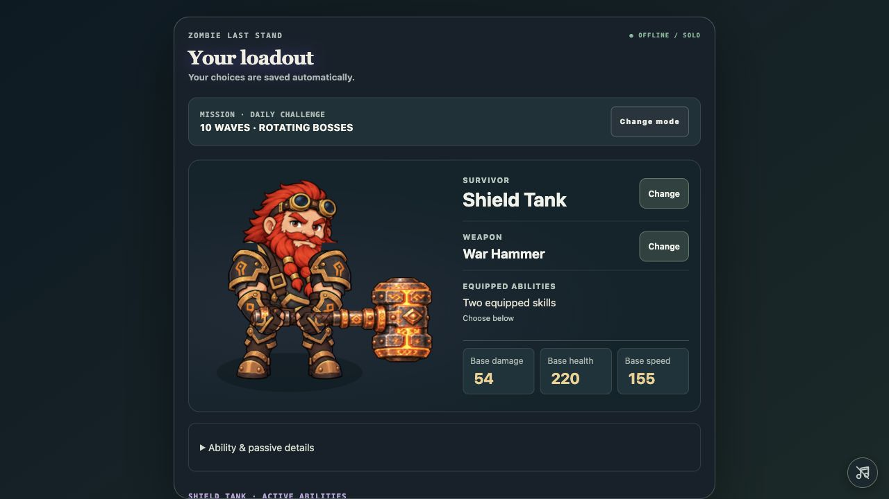
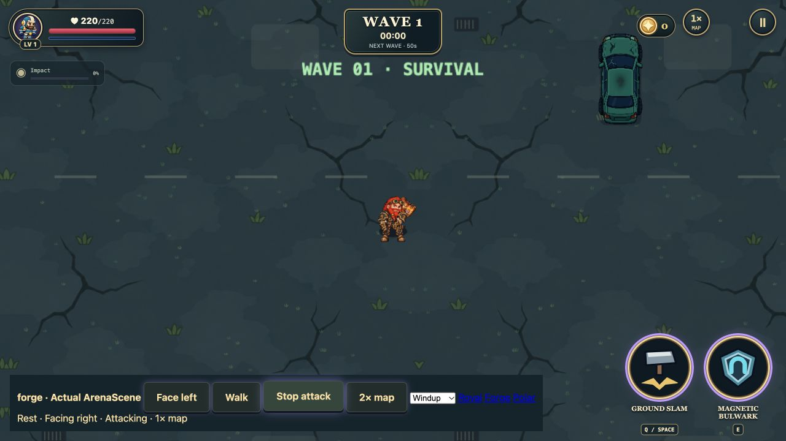

# Shield Tank visual review

The torso artwork contained shoulder plates and arm fragments, while the assembly drew another set of shoulders. The shared shoulder pivots were too high, arm textures were stretched to generic anchors, and shop portraits used the assembled source illustration instead of the gameplay rig.

The corrected rig masks the painted arm remnants, uses side-mounted outfit-specific shoulder pivots, maps each whole arm to its painted shoulder and glove anchors with uniform scaling, and holds the hammer with fixed-length arms. Legs rotate from overlapping hip attachments; the dwarf has broader, shorter legs and a wider stance. Head and torso artwork remains stationary. Raised hammers pass behind the head. Weapon previews render directly at higher resolution and fit the complete equipped silhouette. Shop portraits were exported from this same assembly without weapons.

Only visual assembly, rendering and preview assets changed in this fix. Combat geometry, damage, reach, skills, progression, purchases and save logic were not edited.

## Before and after

## Actual home and loadout

## Combat verification

The following captures use the actual ArenaScene and combat renderer with disposable in-memory saves. All three outfits were checked at rest, walking, mirrored, and attacking at both map scales. The dwarf's raised windup was also checked separately. This is controlled renderer verification rather than an extended combat playthrough.

| Outfit | Rest 1× | Walk left 1× | Attack left 1× | Attack left 2× | Attack right 2× | Rest 2× |
|---|---|---|---|---|---|---|
| royal | [Rest](royal-rest-right-1x.png) | [Walk](royal-walk-left-1x.png) | [Attack](royal-attack-left-1x.png) | [Attack](royal-attack-left-2x.png) | [Attack](royal-attack-right-2x.png) | [Rest](royal-rest-right-2x.png) |
| forge | [Rest](forge-rest-right-1x.png) | [Walk](forge-walk-left-1x.png) | [Attack](forge-attack-left-1x.png) | [Attack](forge-attack-left-2x.png) | [Attack](forge-attack-right-2x.png) | [Rest](forge-rest-right-2x.png) |
| polar | [Rest](polar-rest-right-1x.png) | [Walk](polar-walk-left-1x.png) | [Attack](polar-attack-left-1x.png) | [Attack](polar-attack-left-2x.png) | [Attack](polar-attack-right-2x.png) | [Rest](polar-rest-right-2x.png) |

## Automated checks

16 focused checks passed, covering cosmetic save/equipment behavior, mirrored shoulder/glove anchors, constant hammer arm lengths across rotations, and leg clearance throughout the walk cycle. The production build passed. The browser preview also checked that head/torso pixels remain stable while leg frames change.

Interactive checks: http://127.0.0.1:5174/tests/tank-rig-preview.html and http://127.0.0.1:5174/tests/tank-rig-combat.html
