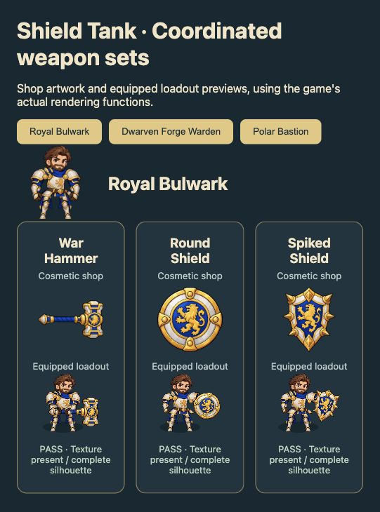
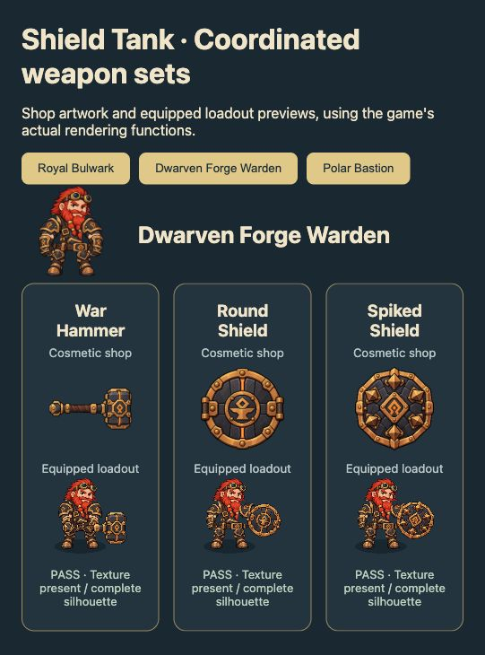
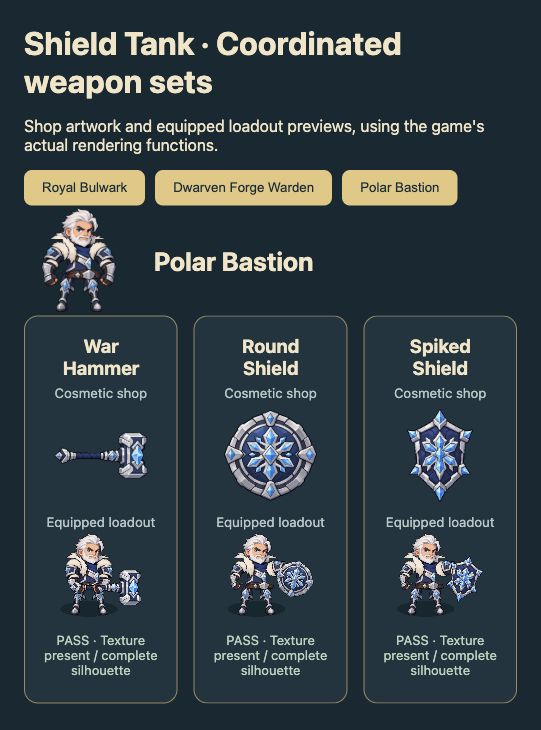
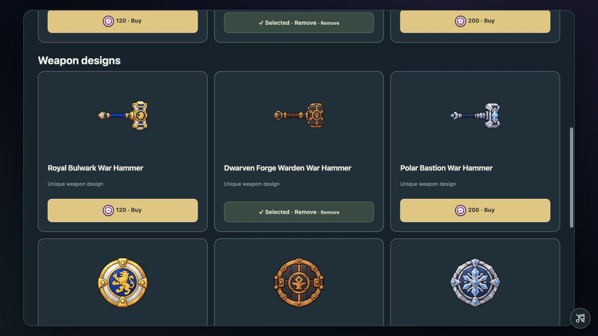
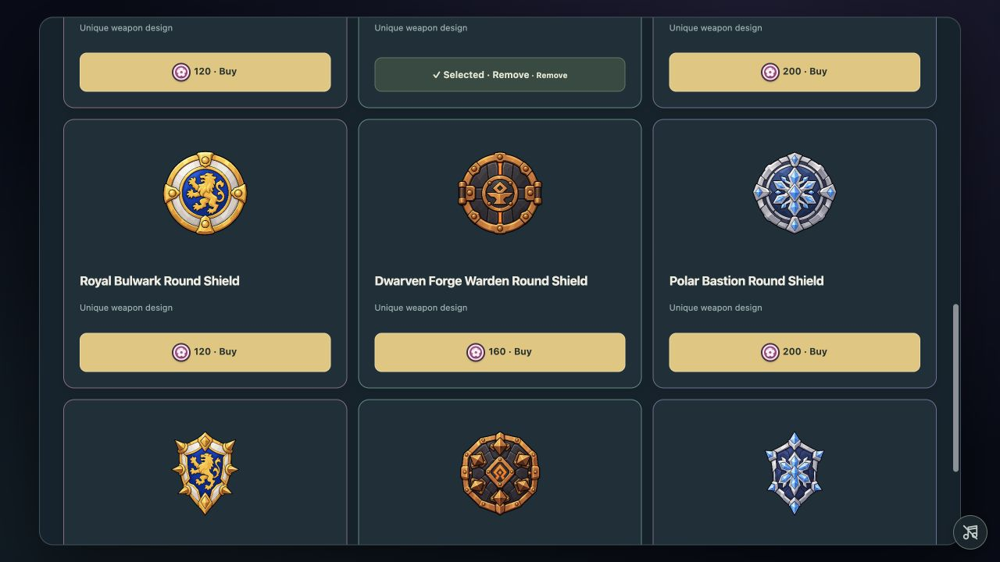
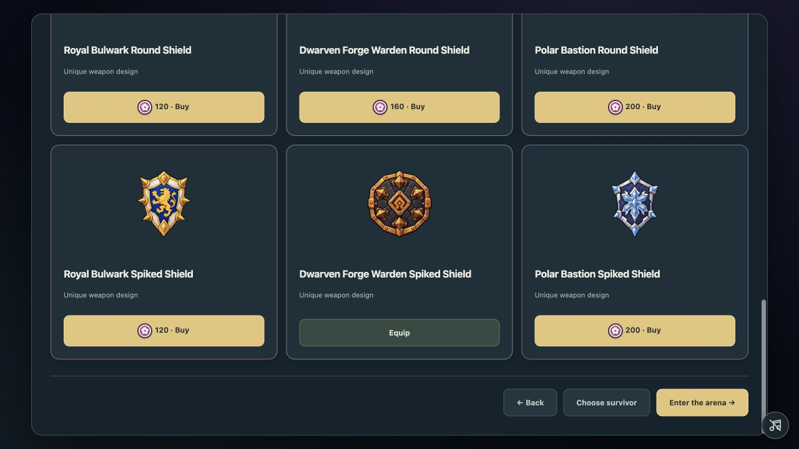
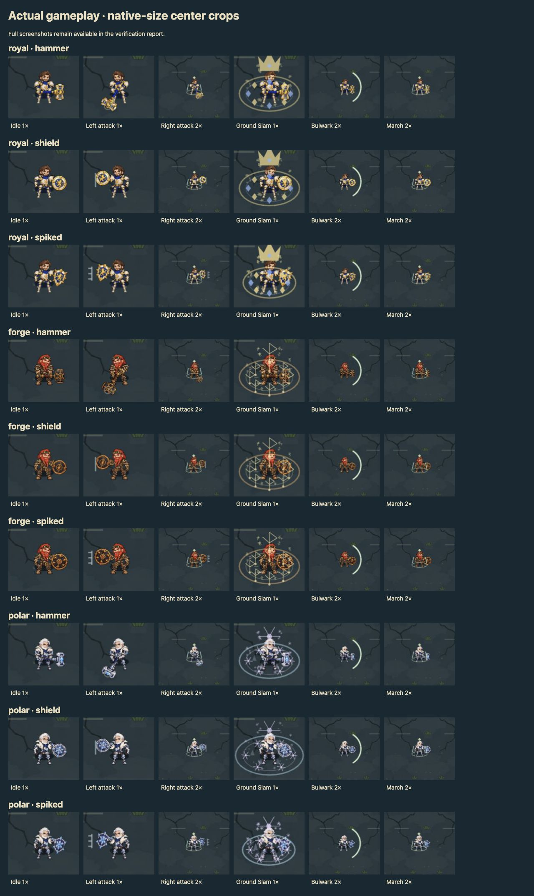

# Shield Tank coordinated weapon sets

Implemented nine new weapon designs through the existing cosmetic IDs: Royal Bulwark, Dwarven Forge Warden and Polar Bastion each have a War Hammer, Round Shield and Spiked Shield.

Royal uses ivory steel, gold, blue and lion heraldry. Forge uses dark iron, copper, leather, furnace hardware and orange runes. Polar uses navy steel, silver armor and protected blue crystals. The three spiked shields have distinct kite, octagonal and angular frost silhouettes.

## Integration

The previous weapon art shared character sprite sheets and used fixed crop rectangles. The replacement art uses three isolated atlas cells per theme, with measured hammer grips and centered shield handles. Uniform scaling preserves the original shape. Shop previews frame the complete silhouette; home/loadout and combat use the same packed art.

The current cosmetic IDs, prices, ownership and equipped-save fields are retained. Character and weapon selection remain independent. No combat stats, weapon reach, hitboxes, attack timing or cosmetic effect behavior were edited.

## Coordinated set screenshots

## Real cosmetic shop

## Gameplay verification

All nine designs were loaded in the actual ArenaScene using disposable in-memory saves. Captures cover idle, walking, mirrored attacks, 1×/2× map views and successful activation of Ground Slam, Magnetic Bulwark and Wrecking March. Combined attack/ability layering was also checked. These are controlled gameplay-renderer checks, not an extended balance playthrough.

| Design | Idle 1× | Left attack 1× | Right attack 2× | Slam 1× / 2× | Bulwark 1× / 2× | March 1× / 2× |
|---|---|---|---|---|---|---|
| royal hammer | [Idle](royal-hammer-idle-1x.png) | [Attack](royal-hammer-attack-left-1x.png) | [Attack](royal-hammer-attack-right-2x.png) | [1×](royal-hammer-slam-1x.png) / [2×](royal-hammer-slam-2x.png) | [1×](royal-hammer-bulwark-1x.png) / [2×](royal-hammer-bulwark-2x.png) | [1×](royal-hammer-march-1x.png) / [2×](royal-hammer-march-2x.png) |
| royal shield | [Idle](royal-shield-idle-1x.png) | [Attack](royal-shield-attack-left-1x.png) | [Attack](royal-shield-attack-right-2x.png) | [1×](royal-shield-slam-1x.png) / [2×](royal-shield-slam-2x.png) | [1×](royal-shield-bulwark-1x.png) / [2×](royal-shield-bulwark-2x.png) | [1×](royal-shield-march-1x.png) / [2×](royal-shield-march-2x.png) |
| royal spiked | [Idle](royal-spiked-idle-1x.png) | [Attack](royal-spiked-attack-left-1x.png) | [Attack](royal-spiked-attack-right-2x.png) | [1×](royal-spiked-slam-1x.png) / [2×](royal-spiked-slam-2x.png) | [1×](royal-spiked-bulwark-1x.png) / [2×](royal-spiked-bulwark-2x.png) | [1×](royal-spiked-march-1x.png) / [2×](royal-spiked-march-2x.png) |
| forge hammer | [Idle](forge-hammer-idle-1x.png) | [Attack](forge-hammer-attack-left-1x.png) | [Attack](forge-hammer-attack-right-2x.png) | [1×](forge-hammer-slam-1x.png) / [2×](forge-hammer-slam-2x.png) | [1×](forge-hammer-bulwark-1x.png) / [2×](forge-hammer-bulwark-2x.png) | [1×](forge-hammer-march-1x.png) / [2×](forge-hammer-march-2x.png) |
| forge shield | [Idle](forge-shield-idle-1x.png) | [Attack](forge-shield-attack-left-1x.png) | [Attack](forge-shield-attack-right-2x.png) | [1×](forge-shield-slam-1x.png) / [2×](forge-shield-slam-2x.png) | [1×](forge-shield-bulwark-1x.png) / [2×](forge-shield-bulwark-2x.png) | [1×](forge-shield-march-1x.png) / [2×](forge-shield-march-2x.png) |
| forge spiked | [Idle](forge-spiked-idle-1x.png) | [Attack](forge-spiked-attack-left-1x.png) | [Attack](forge-spiked-attack-right-2x.png) | [1×](forge-spiked-slam-1x.png) / [2×](forge-spiked-slam-2x.png) | [1×](forge-spiked-bulwark-1x.png) / [2×](forge-spiked-bulwark-2x.png) | [1×](forge-spiked-march-1x.png) / [2×](forge-spiked-march-2x.png) |
| polar hammer | [Idle](polar-hammer-idle-1x.png) | [Attack](polar-hammer-attack-left-1x.png) | [Attack](polar-hammer-attack-right-2x.png) | [1×](polar-hammer-slam-1x.png) / [2×](polar-hammer-slam-2x.png) | [1×](polar-hammer-bulwark-1x.png) / [2×](polar-hammer-bulwark-2x.png) | [1×](polar-hammer-march-1x.png) / [2×](polar-hammer-march-2x.png) |
| polar shield | [Idle](polar-shield-idle-1x.png) | [Attack](polar-shield-attack-left-1x.png) | [Attack](polar-shield-attack-right-2x.png) | [1×](polar-shield-slam-1x.png) / [2×](polar-shield-slam-2x.png) | [1×](polar-shield-bulwark-1x.png) / [2×](polar-shield-bulwark-2x.png) | [1×](polar-shield-march-1x.png) / [2×](polar-shield-march-2x.png) |
| polar spiked | [Idle](polar-spiked-idle-1x.png) | [Attack](polar-spiked-attack-left-1x.png) | [Attack](polar-spiked-attack-right-2x.png) | [1×](polar-spiked-slam-1x.png) / [2×](polar-spiked-slam-2x.png) | [1×](polar-spiked-bulwark-1x.png) / [2×](polar-spiked-bulwark-2x.png) | [1×](polar-spiked-march-1x.png) / [2×](polar-spiked-march-2x.png) |

18 focused automated checks passed, including cosmetic ownership/save compatibility, independent selections, theme-to-cell mapping, preserved aspect ratios, hand anchors and the existing Tank rig checks. The production build passed. No rendering errors were reported by the final gameplay test page.

## Assets and generation prompts

Artwork was created with the built-in imagegen tool, using the approved character portraits as style references. Original individual transparent PNGs and the three game-ready atlases are saved in [tank-weapons-v2](/Users/mintayza/Desktop/Gaming/zombie-last-stand/public/assets/cosmetics/tank-weapons-v2). Existing source artwork was retained.

[Exact prompt set and source filenames](generation-prompts.json). [Browser verification results](browser-checks.json).

The packing preview is at http://127.0.0.1:5174/tests/tank-weapon-pack.html. It exports 512-pixel cells with the measured hand anchors. The coordinated review is at http://127.0.0.1:5174/tests/tank-weapons-preview.html. The controlled combat check is at http://127.0.0.1:5174/tests/tank-rig-combat.html.
